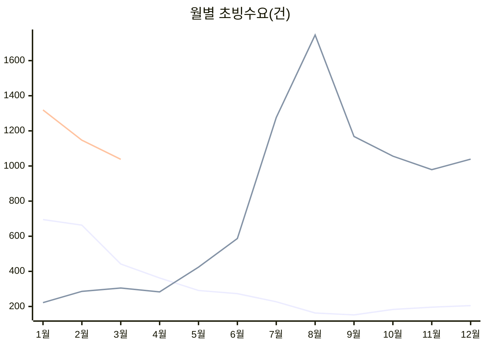
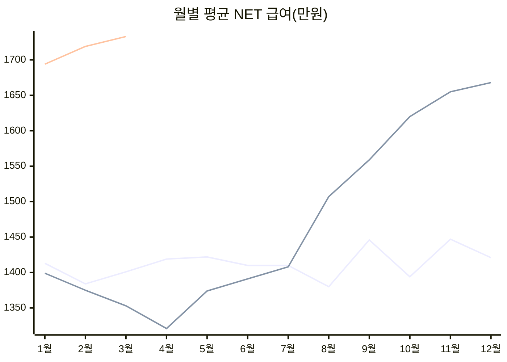

# 안과 의사 초빙·급여 리포트 (2026년 1~3월)

<!-- AUTO:meta START (자동 생성 — 직접 수정 금지) -->
- 진료과: [[ophthalmology|안과]]
- 분석 기간: **2026.01~03** (비교: 2025.01~03, 전년 동기)
- 병원 필터: 전체 / 지역 범위: 전국
- 원본 대시보드: [ophthalmology_2026q1.html](../../raw/dashboards/ophthalmology_2026q1.html)
- 추출 데이터: [ophthalmology_2026q1.json](../../raw/data/ophthalmology_2026q1.json) · Dataview 데이터: [[data-ophthalmology-2026q1]]
- 출처·방법론: [[methodology|데이터 방법론]] · 표본수 기준: [[sample-size|표본수 해석]]
<!-- AUTO:meta END -->

## 요약

- 2026년 1~3월 안과 [[recruitment-demand|초빙수요]]는 **3,504건**으로 전년 동기 813건 대비 **+331.0%** 급증했다.
- 월별로 보면 2025년 7월(1,276건)을 기점으로 수요가 계단식으로 뛰었고, 이후 매월 1천 건 안팎이 유지되고 있다.
- 전국 [[net-salary|NET 급여]] 월평균(참고치)은 **1,715만원**으로 전년 동기 대비 +24.6% 올랐다. 월별 급여는 2025년 8월부터 오르기 시작해 2026년 3월 1,733만원을 기록했다.
- 17개 시도 중 [[ulsan|울산]](-4.6%)을 제외한 16곳에서 급여가 올랐다. 상승폭은 [[incheon|인천]](+37.9%), [[seoul|서울]](+32.7%), [[gyeongnam|경남]](+31.5%) 순으로 컸다.
- 수요는 [[clinic|의원]]이 중심이다. 서울은 2026년 초빙수요의 92.2%가 의원이다.

## 핵심 지표

<!-- AUTO:kpi START (자동 생성 — 직접 수정 금지) -->
| 지표 | 2025.01~03 | 2026.01~03 | 증감 |
| --- | --: | --: | --: |
| [[recruitment-demand\|초빙수요]] 합계(건) | 813 | 3,504 | ▲ 2,691건 (+331.0%) |
| 전국 [[net-salary\|NET 급여]] 월평균(만원)* | 1,376 | 1,715 | ▲ 339만원 (+24.6%) |

\* 월별 평균 NET 급여(fig4)의 해당 월 값을 단순 평균한 참고치입니다.
<!-- AUTO:kpi END -->

## 월별 초빙수요

<!-- AUTO:demand-monthly START (자동 생성 — 직접 수정 금지) -->
| 월 | 2024년 | 2025년 | 2026년 |
| --- | --: | --: | --: |
| 1월 | 695 | 222 | 1,319 |
| 2월 | 663 | 286 | 1,147 |
| 3월 | 442 | 305 | 1,038 |
| 4월 | 362 | 283 | – |
| 5월 | 291 | 424 | – |
| 6월 | 273 | 587 | – |
| 7월 | 227 | 1,276 | – |
| 8월 | 163 | 1,746 | – |
| 9월 | 152 | 1,168 | – |
| 10월 | 183 | 1,056 | – |
| 11월 | 196 | 979 | – |
| 12월 | 205 | 1,039 | – |

범례: 1번째 선=2024년, 2번째 선=2025년, 3번째 선=2026년
<!-- AUTO:demand-monthly END -->

## 지역별 병원 규모별 초빙수요 비중

<!-- AUTO:demand-mix START (자동 생성 — 직접 수정 금지) -->
| 지역 | 연도 | [[general-hospital\|종합병원]] | [[hospital\|병원]] | [[nursing-hospital\|요양병원]] | [[clinic\|의원]] |
| --- | --- | --: | --: | --: | --: |
| [[seoul\|서울]] | 2025 | 10.9% | 3.4% | 4.1% | 81.6% |
| [[seoul\|서울]] | 2026 | 3.2% | 1.7% | 2.9% | 92.2% |
| [[busan\|부산]] | 2025 | 10% | 10% | 0% | 80% |
| [[busan\|부산]] | 2026 | 10.7% | 9.5% | 15.5% | 64.3% |
| [[daegu\|대구]] | 2025 | 0% | 5.6% | 11.1% | 83.3% |
| [[daegu\|대구]] | 2026 | 4.3% | 3.6% | 20.9% | 71.2% |
| [[incheon\|인천]] | 2025 | 12.8% | 2.6% | 5.1% | 79.5% |
| [[incheon\|인천]] | 2026 | 3.2% | 7.8% | 11.9% | 77.1% |
| [[gwangju\|광주]] | 2025 | 37.5% | 0% | 6.3% | 56.2% |
| [[gwangju\|광주]] | 2026 | 13.7% | 4.1% | 20.5% | 61.7% |
| [[daejeon\|대전]] | 2025 | 45% | 0% | 5% | 50% |
| [[daejeon\|대전]] | 2026 | 7.3% | 5.2% | 5.2% | 82.3% |
| [[ulsan\|울산]] | 2025 | 25% | 5% | 5% | 65% |
| [[ulsan\|울산]] | 2026 | 7.5% | 7.5% | 22.6% | 62.4% |
| [[sejong\|세종]] | 2025 | 0% | 11.1% | 0% | 88.9% |
| [[sejong\|세종]] | 2026 | 5.9% | 0% | 0% | 94.1% |
| [[gyeonggi\|경기]] | 2025 | 13.5% | 5.8% | 6.4% | 74.3% |
| [[gyeonggi\|경기]] | 2026 | 3.8% | 4.4% | 9.1% | 82.7% |
| [[gangwon\|강원]] | 2025 | 22.2% | 0% | 37% | 40.8% |
| [[gangwon\|강원]] | 2026 | 6.8% | 16.2% | 18.9% | 58.1% |
| [[chungbuk\|충북]] | 2025 | 43.8% | 12.5% | 12.5% | 31.2% |
| [[chungbuk\|충북]] | 2026 | 9.5% | 5.4% | 6.8% | 78.3% |
| [[chungnam\|충남]] | 2025 | 14.3% | 14.3% | 21.4% | 50% |
| [[chungnam\|충남]] | 2026 | 7.2% | 13% | 20.3% | 59.5% |
| [[jeonbuk\|전북]] | 2025 | 19.2% | 11.5% | 23.1% | 46.2% |
| [[jeonbuk\|전북]] | 2026 | 5.9% | 11.8% | 52.9% | 29.4% |
| [[jeonnam\|전남]] | 2025 | 26.7% | 13.3% | 33.3% | 26.7% |
| [[jeonnam\|전남]] | 2026 | 14.9% | 17.9% | 47.8% | 19.4% |
| [[gyeongbuk\|경북]] | 2025 | 38.5% | 15.4% | 23.1% | 23% |
| [[gyeongbuk\|경북]] | 2026 | 27.4% | 5.5% | 27.4% | 39.7% |
| [[gyeongnam\|경남]] | 2025 | 14% | 2.3% | 32.6% | 51.1% |
| [[gyeongnam\|경남]] | 2026 | 8.2% | 19% | 29.7% | 43.1% |
| [[jeju\|제주]] | 2025 | 0% | 0% | 10% | 90% |
| [[jeju\|제주]] | 2026 | 0% | 0% | 20% | 80% |
<!-- AUTO:demand-mix END -->

## 권역별 초빙수요 증감

<!-- AUTO:demand-yoy START (자동 생성 — 직접 수정 금지) -->
| 권역 | 지역 | 2025.01~03 → 2026.01~03 |
| --- | --- | --- |
| [[capital-area\|수도권]] | [[seoul\|서울]] | ▲ 증가 21.9% |
| [[capital-area\|수도권]] | [[gyeonggi\|경기]] | ▲ 증가 47.6% |
| [[capital-area\|수도권]] | [[incheon\|인천]] | ▲ 증가 40% |
| [[yeongnam-area\|영남권]] | [[busan\|부산]] | ▲ 증가 533.3% |
| [[yeongnam-area\|영남권]] | [[ulsan\|울산]] | ▼ 감소 20% |
| [[yeongnam-area\|영남권]] | [[gyeongnam\|경남]] | ▲ 증가 116.7% |
| [[yeongnam-area\|영남권]] | [[gyeongbuk\|경북]] | ▲ 증가 100% |
| [[jeju-area\|제주권]] | – | 조건에 부합하는 데이터가 없습니다. |

대시보드 원문 기준 **종합병원 초빙수요**의 전년 동기 대비 증감률입니다.
<!-- AUTO:demand-yoy END -->

## 지역별 NET 평균 급여 (전체 병원)

<!-- AUTO:salary-region START (자동 생성 — 직접 수정 금지) -->
| 지역 | 2025.01~03 | 2026.01~03 | 증감 |
| --- | --: | --: | --: |
| [[seoul\|서울]] | 1,298 (n=294) | 1,723 (n=1226) | ▲ 425만원 (+32.7%) |
| [[busan\|부산]] | 1,422 (n=30) | 1,693 (n=168) | ▲ 271만원 (+19.1%) |
| [[daegu\|대구]] | 1,349 (n=36) | 1,609 (n=139) | ▲ 260만원 (+19.3%) |
| [[incheon\|인천]] | 1,324 (n=39) | 1,826 (n=218) | ▲ 502만원 (+37.9%) |
| [[gwangju\|광주]] | 1,521 (n=16) | 1,600 (n=73) | ▲ 79만원 (+5.2%) |
| [[daejeon\|대전]] | 1,494 (n=20) | 1,623 (n=96) | ▲ 129만원 (+8.6%) |
| [[ulsan\|울산]] | 1,613 (n=20) | 1,539 (n=53) | ▼ 74만원 (-4.6%) |
| [[sejong\|세종]] | 1,319 (n=9) ⚠️ | 1,685 (n=17) | ▲ 366만원 (+27.7%) |
| [[gyeonggi\|경기]] | 1,446 (n=156) | 1,753 (n=821) | ▲ 307만원 (+21.2%) |
| [[gangwon\|강원]] | 1,413 (n=27) | 1,702 (n=74) | ▲ 289만원 (+20.5%) |
| [[chungbuk\|충북]] | 1,552 (n=16) | 1,832 (n=74) | ▲ 280만원 (+18.0%) |
| [[chungnam\|충남]] | 1,454 (n=28) | 1,730 (n=69) | ▲ 276만원 (+19.0%) |
| [[jeonbuk\|전북]] | 1,263 (n=26) | 1,461 (n=85) | ▲ 198만원 (+15.7%) |
| [[jeonnam\|전남]] | 1,573 (n=15) | 1,646 (n=67) | ▲ 73만원 (+4.6%) |
| [[gyeongbuk\|경북]] | 1,419 (n=26) | 1,671 (n=73) | ▲ 252만원 (+17.8%) |
| [[gyeongnam\|경남]] | 1,282 (n=43) | 1,686 (n=158) | ▲ 404만원 (+31.5%) |
| [[jeju\|제주]] | 1,355 (n=10) | 1,732 (n=30) | ▲ 377만원 (+27.8%) |

단위: 만원(월, NET). n=표본 공고 수, ⚠️ = n<10.
<!-- AUTO:salary-region END -->

## 권역·병원유형별 NET 평균 급여

<!-- AUTO:salary-group START (자동 생성 — 직접 수정 금지) -->
**[[capital-area|수도권]] · [[general-hospital|종합병원]]**

| 지역 | 2025.01~03 | 2026.01~03 | 증감 |
| --- | --: | --: | --: |
| [[seoul\|서울]] | 1,458 (n=32) | 1,824 (n=39) | ▲ 366만원 (+25.1%) |
| [[gyeonggi\|경기]] | 1,842 (n=21) | 1,790 (n=31) | ▼ 52만원 (-2.8%) |
| [[incheon\|인천]] | 1,667 (n=5) ⚠️ | 1,772 (n=7) ⚠️ | ▲ 105만원 (+6.3%) |

**[[capital-area|수도권]] · [[clinic|의원]]**

| 지역 | 2025.01~03 | 2026.01~03 | 증감 |
| --- | --: | --: | --: |
| [[seoul\|서울]] | 1,306 (n=181) | 1,743 (n=854) | ▲ 437만원 (+33.5%) |
| [[gyeonggi\|경기]] | 1,428 (n=103) | 1,810 (n=508) | ▲ 382만원 (+26.8%) |
| [[incheon\|인천]] | 1,262 (n=27) | 1,917 (n=143) | ▲ 655만원 (+51.9%) |

**[[yeongnam-area|영남권]] · [[general-hospital|종합병원]]**

| 지역 | 2025.01~03 | 2026.01~03 | 증감 |
| --- | --: | --: | --: |
| [[busan\|부산]] | 1,696 (n=3) ⚠️ | 1,878 (n=19) | ▲ 182만원 (+10.7%) |
| [[daegu\|대구]] | – | 1,967 (n=6) ⚠️ | – |
| [[ulsan\|울산]] | 1,654 (n=5) ⚠️ | 1,814 (n=4) ⚠️ | ▲ 160만원 (+9.7%) |
| [[gyeongnam\|경남]] | 1,584 (n=6) ⚠️ | 1,951 (n=13) | ▲ 367만원 (+23.2%) |
| [[gyeongbuk\|경북]] | 1,652 (n=10) | 2,021 (n=20) | ▲ 369만원 (+22.3%) |

**[[yeongnam-area|영남권]] · [[clinic|의원]]**

| 지역 | 2025.01~03 | 2026.01~03 | 증감 |
| --- | --: | --: | --: |
| [[busan\|부산]] | 1,358 (n=23) | 1,876 (n=80) | ▲ 518만원 (+38.1%) |
| [[daegu\|대구]] | 1,343 (n=24) | 1,681 (n=74) | ▲ 338만원 (+25.2%) |
| [[ulsan\|울산]] | 1,860 (n=4) ⚠️ | 1,656 (n=17) | ▼ 204만원 (-11.0%) |
| [[gyeongnam\|경남]] | 1,299 (n=17) | 1,945 (n=44) | ▲ 646만원 (+49.7%) |
| [[gyeongbuk\|경북]] | 1,253 (n=4) ⚠️ | 1,765 (n=24) | ▲ 512만원 (+40.9%) |

**[[jeju-area|제주권]] · [[general-hospital|종합병원]]**

| 지역 | 2025.01~03 | 2026.01~03 | 증감 |
| --- | --: | --: | --: |
| [[jeju\|제주]] | – | – | – |

**[[jeju-area|제주권]] · [[clinic|의원]]**

| 지역 | 2025.01~03 | 2026.01~03 | 증감 |
| --- | --: | --: | --: |
| [[jeju\|제주]] | 1,425 (n=7) ⚠️ | 1,865 (n=23) | ▲ 440만원 (+30.9%) |
<!-- AUTO:salary-group END -->

## 월별 평균 NET 급여 추이

<!-- AUTO:salary-monthly START (자동 생성 — 직접 수정 금지) -->
| 월 | 2024년 | 2025년 | 2026년 |
| --- | --: | --: | --: |
| 1월 | 1,413 | 1,399 | 1,694 |
| 2월 | 1,384 | 1,375 | 1,719 |
| 3월 | 1,401 | 1,353 | 1,733 |
| 4월 | 1,419 | 1,321 | – |
| 5월 | 1,422 | 1,374 | – |
| 6월 | 1,410 | 1,391 | – |
| 7월 | 1,410 | 1,408 | – |
| 8월 | 1,380 | 1,507 | – |
| 9월 | 1,446 | 1,559 | – |
| 10월 | 1,394 | 1,620 | – |
| 11월 | 1,447 | 1,655 | – |
| 12월 | 1,421 | 1,668 | – |

범례: 1번째 선=2024년, 2번째 선=2025년, 3번째 선=2026년
<!-- AUTO:salary-monthly END -->

## 해석 및 시사점

- **수요 우위 시장 신호**: 수요 급증과 급여 상승이 함께 나타난다. 구인 경쟁이 급여를 끌어올리는 구조로 보인다.
- **2025년 7월 급증은 원인 확인 필요**: 한 달 사이 수요가 두 배 이상 뛴 것은 시장 변화일 수도 있지만, 공고 수집 범위나 집계 방식이 바뀐 결과일 수도 있다. 원천 데이터를 확인하기 전까지 원인을 단정하지 않는다. → [[methodology|데이터 방법론]]
- **의원 급여 상승폭이 종합병원보다 크다**:
  - 서울: 의원 +33.5%, [[general-hospital|종합병원]] +25.1%
  - [[gyeonggi|경기]]: 종합병원은 -2.8%로 소폭 하락, 의원은 +26.8%
  - 인천: 의원 1,917만원이 종합병원 1,772만원보다 높다. 다만 종합병원은 n=7로 표본이 부족하다.
- **표본 주의**: 영남권 종합병원은 다수 지역이 n<10이다. [[daegu|대구]] 종합병원은 전년 값이 없고, [[jeju|제주]] 종합병원은 두 기간 모두 데이터가 없다. → [[sample-size|표본수 해석]]
- **다음 확인 포인트**: 2026년 2분기 리포트에서 월 1천 건 수준의 수요가 유지되는지, 급여 상승이 이어지는지 본다.
- 관련 분석: [[ophthalmology-vs-pulmonology-2026q1|안과 vs 호흡기내과]]

## 데이터 처리 노트

<!-- AUTO:processing-notes START (자동 생성 — 직접 수정 금지) -->
- 월별 급여 2026-04 값(1746)은 분석 기간 밖이라 제외
<!-- AUTO:processing-notes END -->
