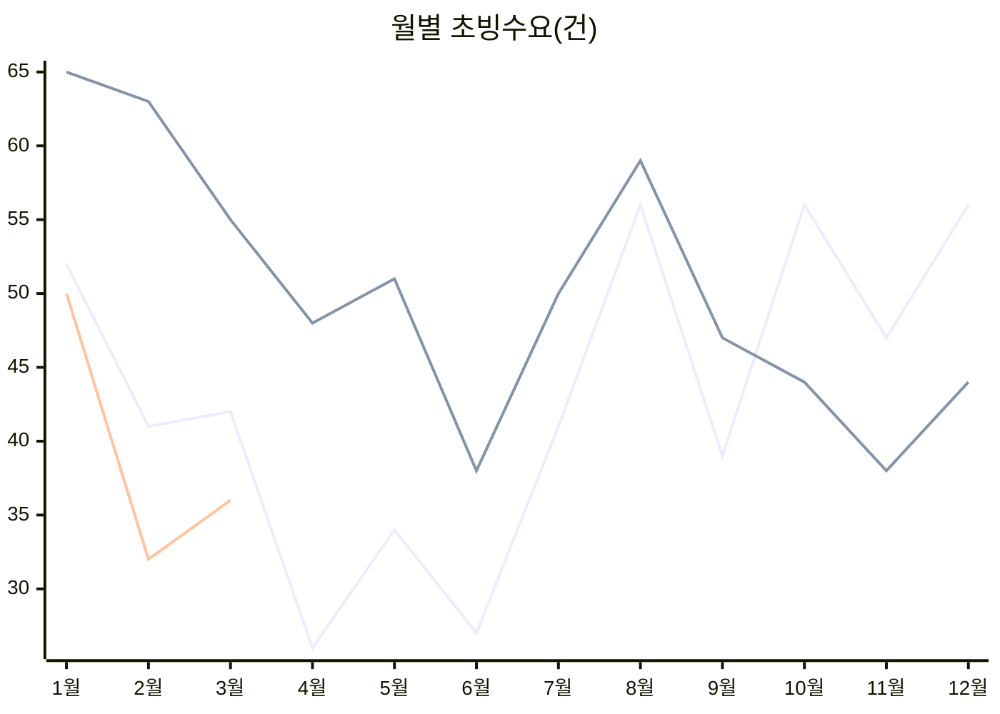
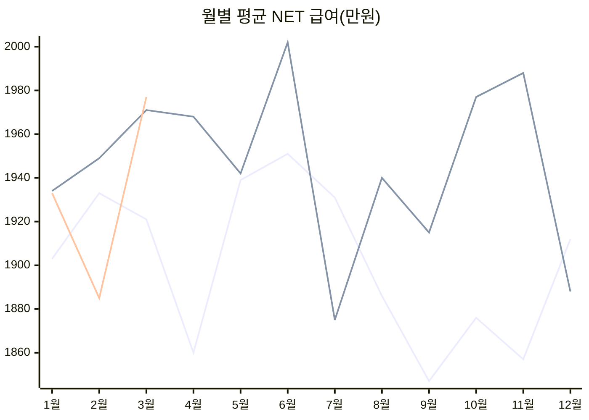

# 호흡기내과 의사 초빙·급여 리포트 (2026년 1~3월)

<!-- AUTO:meta START (자동 생성 — 직접 수정 금지) -->
- 진료과: [[pulmonology|호흡기내과]]
- 분석 기간: **2026.01~03** (비교: 2025.01~03, 전년 동기)
- 병원 필터: 전체 / 지역 범위: 전국
- 원본 대시보드: [pulmonology_2026q1.html](../../raw/dashboards/pulmonology_2026q1.html)
- 추출 데이터: [pulmonology_2026q1.json](../../raw/data/pulmonology_2026q1.json) · Dataview 데이터: [[data-pulmonology-2026q1]]
- 출처·방법론: [[methodology|데이터 방법론]] · 표본수 기준: [[sample-size|표본수 해석]]
<!-- AUTO:meta END -->

## 요약

- 2026년 1~3월 호흡기내과 [[recruitment-demand|초빙수요]]는 **118건**으로 전년 동기 183건 대비 **-35.5%** 줄었다. 2024년 같은 기간보다도 적다.
- 전국 [[net-salary|NET 급여]] 월평균(참고치)은 **1,932만원**(-1.0%)으로 보합이다. 월별 급여도 2024~2026년 내내 좁은 범위에서 움직였다.
- 수요는 [[general-hospital|종합병원]]이 중심이다. 2026년 [[gyeonggi|경기]] 수요는 100% 종합병원이다. [[clinic|의원]] 급여는 사실상 데이터가 없다.
- 지역 급여는 대부분 표본이 작다. 표본이 10건 이상인 지역만 보면:
  - [[seoul|서울]] 1,961만원(n=12, +18.6%)
  - [[busan|부산]] 1,869만원(n=14, +15.5%)
  - [[incheon|인천]] 1,898만원(n=22, -2.9%)
  - 경기 2,018만원(n=11, -0.6%)
  - [[chungbuk|충북]] 1,958만원(n=13, +1.0%)

## 핵심 지표

<!-- AUTO:kpi START (자동 생성 — 직접 수정 금지) -->
| 지표 | 2025.01~03 | 2026.01~03 | 증감 |
| --- | --: | --: | --: |
| [[recruitment-demand\|초빙수요]] 합계(건) | 183 | 118 | ▼ 65건 (-35.5%) |
| 전국 [[net-salary\|NET 급여]] 월평균(만원)* | 1,951 | 1,932 | ▼ 19만원 (-1.0%) |

\* 월별 평균 NET 급여(fig4)의 해당 월 값을 단순 평균한 참고치입니다.
<!-- AUTO:kpi END -->

## 월별 초빙수요

<!-- AUTO:demand-monthly START (자동 생성 — 직접 수정 금지) -->
| 월 | 2024년 | 2025년 | 2026년 |
| --- | --: | --: | --: |
| 1월 | 52 | 65 | 50 |
| 2월 | 41 | 63 | 32 |
| 3월 | 42 | 55 | 36 |
| 4월 | 26 | 48 | – |
| 5월 | 34 | 51 | – |
| 6월 | 27 | 38 | – |
| 7월 | 41 | 50 | – |
| 8월 | 56 | 59 | – |
| 9월 | 39 | 47 | – |
| 10월 | 56 | 44 | – |
| 11월 | 47 | 38 | – |
| 12월 | 56 | 44 | – |

범례: 1번째 선=2024년, 2번째 선=2025년, 3번째 선=2026년
<!-- AUTO:demand-monthly END -->

## 지역별 병원 규모별 초빙수요 비중

<!-- AUTO:demand-mix START (자동 생성 — 직접 수정 금지) -->
| 지역 | 연도 | [[general-hospital\|종합병원]] | [[hospital\|병원]] | [[nursing-hospital\|요양병원]] | [[clinic\|의원]] |
| --- | --- | --: | --: | --: | --: |
| [[seoul\|서울]] | 2025 | 100% | 0% | 0% | 0% |
| [[seoul\|서울]] | 2026 | 41.7% | 50% | 0% | 8.3% |
| [[busan\|부산]] | 2025 | 100% | 0% | 0% | 0% |
| [[busan\|부산]] | 2026 | 92.9% | 7.1% | 0% | 0% |
| [[daegu\|대구]] | 2025 | 100% | 0% | 0% | 0% |
| [[daegu\|대구]] | 2026 | 0% | 100% | 0% | 0% |
| [[incheon\|인천]] | 2025 | 66.7% | 33.3% | 0% | 0% |
| [[incheon\|인천]] | 2026 | 81.8% | 18.2% | 0% | 0% |
| [[gwangju\|광주]] | 2025 | 100% | 0% | 0% | 0% |
| [[gwangju\|광주]] | 2026 | 80% | 20% | 0% | 0% |
| [[daejeon\|대전]] | 2025 | 100% | 0% | 0% | 0% |
| [[daejeon\|대전]] | 2026 | 100% | 0% | 0% | 0% |
| [[ulsan\|울산]] | 2025 | 0% | 100% | 0% | 0% |
| [[ulsan\|울산]] | 2026 | 0% | 0% | 0% | 100% |
| [[gyeonggi\|경기]] | 2025 | 94.8% | 0% | 0% | 5.2% |
| [[gyeonggi\|경기]] | 2026 | 100% | 0% | 0% | 0% |
| [[gangwon\|강원]] | 2025 | 100% | 0% | 0% | 0% |
| [[gangwon\|강원]] | 2026 | 0% | 0% | 0% | 100% |
| [[chungbuk\|충북]] | 2025 | 100% | 0% | 0% | 0% |
| [[chungbuk\|충북]] | 2026 | 100% | 0% | 0% | 0% |
| [[chungnam\|충남]] | 2025 | 100% | 0% | 0% | 0% |
| [[chungnam\|충남]] | 2026 | 100% | 0% | 0% | 0% |
| [[jeonbuk\|전북]] | 2025 | 33.3% | 66.7% | 0% | 0% |
| [[jeonbuk\|전북]] | 2026 | 100% | 0% | 0% | 0% |
| [[jeonnam\|전남]] | 2025 | 66.7% | 33.3% | 0% | 0% |
| [[jeonnam\|전남]] | 2026 | 100% | 0% | 0% | 0% |
| [[gyeongbuk\|경북]] | 2025 | 100% | 0% | 0% | 0% |
| [[gyeongbuk\|경북]] | 2026 | 100% | 0% | 0% | 0% |
| [[gyeongnam\|경남]] | 2025 | 100% | 0% | 0% | 0% |
| [[gyeongnam\|경남]] | 2026 | 33.3% | 66.7% | 0% | 0% |
| [[jeju\|제주]] | 2025 | 100% | 0% | 0% | 0% |
| [[jeju\|제주]] | 2026 | 100% | 0% | 0% | 0% |
<!-- AUTO:demand-mix END -->

## 권역별 초빙수요 증감

<!-- AUTO:demand-yoy START (자동 생성 — 직접 수정 금지) -->
| 권역 | 지역 | 2025.01~03 → 2026.01~03 |
| --- | --- | --- |
| [[capital-area\|수도권]] | [[seoul\|서울]] | ▼ 감소 50% |
| [[capital-area\|수도권]] | [[gyeonggi\|경기]] | ▼ 감소 79.6% |
| [[capital-area\|수도권]] | [[incheon\|인천]] | ▼ 감소 25% |
| [[yeongnam-area\|영남권]] | [[busan\|부산]] | ▲ 증가 160% |
| [[yeongnam-area\|영남권]] | [[daegu\|대구]] | ▼ 감소 100% |
| [[yeongnam-area\|영남권]] | [[gyeongnam\|경남]] | → 변화 없음 0% |
| [[yeongnam-area\|영남권]] | [[gyeongbuk\|경북]] | ▼ 감소 42.9% |
| [[jeju-area\|제주권]] | [[jeju\|제주]] | ▼ 감소 50% |

대시보드 원문 기준 **종합병원 초빙수요**의 전년 동기 대비 증감률입니다.
<!-- AUTO:demand-yoy END -->

## 지역별 NET 평균 급여 (전체 병원)

<!-- AUTO:salary-region START (자동 생성 — 직접 수정 금지) -->
| 지역 | 2025.01~03 | 2026.01~03 | 증감 |
| --- | --: | --: | --: |
| [[seoul\|서울]] | 1,653 (n=11) | 1,961 (n=12) | ▲ 308만원 (+18.6%) |
| [[busan\|부산]] | 1,618 (n=8) ⚠️ | 1,869 (n=14) | ▲ 251만원 (+15.5%) |
| [[daegu\|대구]] | 2,132 (n=7) ⚠️ | 2,325 (n=1) ⚠️ | ▲ 193만원 (+9.1%) |
| [[incheon\|인천]] | 1,954 (n=36) | 1,898 (n=22) | ▼ 56만원 (-2.9%) |
| [[gwangju\|광주]] | 2,025 (n=2) ⚠️ | 2,005 (n=5) ⚠️ | ▼ 20만원 (-1.0%) |
| [[daejeon\|대전]] | 1,403 (n=4) ⚠️ | 1,736 (n=7) ⚠️ | ▲ 333만원 (+23.7%) |
| [[ulsan\|울산]] | 2,025 (n=1) ⚠️ | – | – |
| [[gyeonggi\|경기]] | 2,030 (n=58) | 2,018 (n=11) | ▼ 12만원 (-0.6%) |
| [[gangwon\|강원]] | 1,955 (n=7) ⚠️ | – | – |
| [[chungbuk\|충북]] | 1,939 (n=15) | 1,958 (n=13) | ▲ 19만원 (+1.0%) |
| [[chungnam\|충남]] | 2,261 (n=6) ⚠️ | 1,992 (n=6) ⚠️ | ▼ 269만원 (-11.9%) |
| [[jeonbuk\|전북]] | 1,878 (n=6) ⚠️ | 2,032 (n=10) | ▲ 154만원 (+8.2%) |
| [[jeonnam\|전남]] | 2,158 (n=3) ⚠️ | 1,359 (n=2) ⚠️ | ▼ 799만원 (-37.0%) |
| [[gyeongbuk\|경북]] | 1,979 (n=14) | 2,072 (n=8) ⚠️ | ▲ 93만원 (+4.7%) |
| [[gyeongnam\|경남]] | 2,525 (n=1) ⚠️ | 2,092 (n=3) ⚠️ | ▼ 433만원 (-17.1%) |
| [[jeju\|제주]] | 1,686 (n=4) ⚠️ | 1,492 (n=2) ⚠️ | ▼ 194만원 (-11.5%) |

단위: 만원(월, NET). n=표본 공고 수, ⚠️ = n<10.
<!-- AUTO:salary-region END -->

## 권역·병원유형별 NET 평균 급여

<!-- AUTO:salary-group START (자동 생성 — 직접 수정 금지) -->
**[[capital-area|수도권]] · [[general-hospital|종합병원]]**

| 지역 | 2025.01~03 | 2026.01~03 | 증감 |
| --- | --: | --: | --: |
| [[seoul\|서울]] | 1,691 (n=10) | 1,960 (n=5) ⚠️ | ▲ 269만원 (+15.9%) |
| [[gyeonggi\|경기]] | 2,031 (n=54) | 2,018 (n=11) | ▼ 13만원 (-0.6%) |
| [[incheon\|인천]] | 1,925 (n=24) | 1,931 (n=18) | ▲ 6만원 (+0.3%) |

**[[capital-area|수도권]] · [[clinic|의원]]**

| 지역 | 2025.01~03 | 2026.01~03 | 증감 |
| --- | --: | --: | --: |
| [[seoul\|서울]] | – | – | – |
| [[gyeonggi\|경기]] | 1,792 (n=3) ⚠️ | – | – |
| [[incheon\|인천]] | – | – | – |

**[[yeongnam-area|영남권]] · [[general-hospital|종합병원]]**

| 지역 | 2025.01~03 | 2026.01~03 | 증감 |
| --- | --: | --: | --: |
| [[busan\|부산]] | 1,845 (n=5) ⚠️ | 1,857 (n=13) | ▲ 12만원 (+0.7%) |
| [[daegu\|대구]] | 2,132 (n=7) ⚠️ | – | – |
| [[ulsan\|울산]] | – | – | – |
| [[gyeongnam\|경남]] | 2,525 (n=1) ⚠️ | 2,225 (n=1) ⚠️ | ▼ 300만원 (-11.9%) |
| [[gyeongbuk\|경북]] | 1,979 (n=14) | 2,072 (n=8) ⚠️ | ▲ 93만원 (+4.7%) |

**[[yeongnam-area|영남권]] · [[clinic|의원]]**

| 지역 | 2025.01~03 | 2026.01~03 | 증감 |
| --- | --: | --: | --: |
| [[busan\|부산]] | – | – | – |
| [[daegu\|대구]] | – | – | – |
| [[ulsan\|울산]] | – | – | – |
| [[gyeongnam\|경남]] | – | – | – |
| [[gyeongbuk\|경북]] | – | – | – |

**[[jeju-area|제주권]] · [[general-hospital|종합병원]]**

| 지역 | 2025.01~03 | 2026.01~03 | 증감 |
| --- | --: | --: | --: |
| [[jeju\|제주]] | 1,686 (n=4) ⚠️ | 1,492 (n=2) ⚠️ | ▼ 194만원 (-11.5%) |

**[[jeju-area|제주권]] · [[clinic|의원]]**

| 지역 | 2025.01~03 | 2026.01~03 | 증감 |
| --- | --: | --: | --: |
| [[jeju\|제주]] | – | – | – |
<!-- AUTO:salary-group END -->

## 월별 평균 NET 급여 추이

<!-- AUTO:salary-monthly START (자동 생성 — 직접 수정 금지) -->
| 월 | 2024년 | 2025년 | 2026년 |
| --- | --: | --: | --: |
| 1월 | 1,903 | 1,934 | 1,933 |
| 2월 | 1,933 | 1,949 | 1,885 |
| 3월 | 1,921 | 1,971 | 1,977 |
| 4월 | 1,860 | 1,968 | – |
| 5월 | 1,939 | 1,942 | – |
| 6월 | 1,951 | 2,002 | – |
| 7월 | 1,931 | 1,875 | – |
| 8월 | 1,886 | 1,940 | – |
| 9월 | 1,847 | 1,915 | – |
| 10월 | 1,876 | 1,977 | – |
| 11월 | 1,857 | 1,988 | – |
| 12월 | 1,912 | 1,888 | – |

범례: 1번째 선=2024년, 2번째 선=2025년, 3번째 선=2026년
<!-- AUTO:salary-monthly END -->

## 해석 및 시사점

- **수요는 줄었지만 급여는 유지**: 수요 감소가 급여 하락으로 이어지지 않았다. 급여가 이미 높은 수준에서 고착된 시장으로 보인다.
- **수도권 수요 급감**: 종합병원 초빙수요가 경기 -79.6%, 서울 -50%, 인천 -25%로 줄었다. 영남권에서는 부산만 +160%로 예외다.
- **지역 간 급여 차이는 표본 효과일 수 있음**: 예를 들어 [[jeonnam|전남]] -37.0%는 n=2에 근거한 값이다. → [[sample-size|표본수 해석]]
- **템플릿 차이**: 이 리포트는 구버전 대시보드라 의원 급여 요약(salary_summary_clinic)이 없다. 권역별 의원 차트 값으로 대체했다(아래 처리 노트 참고).
- 관련 분석: [[ophthalmology-vs-pulmonology-2026q1|안과 vs 호흡기내과]]

## 데이터 처리 노트

<!-- AUTO:processing-notes START (자동 생성 — 직접 수정 금지) -->
- salary_summary_clinic 없음 (템플릿 구버전) → fig3_*_clinic 값으로 대체
- 월별 급여 2026-04 값(2048)은 분석 기간 밖이라 제외
<!-- AUTO:processing-notes END -->
